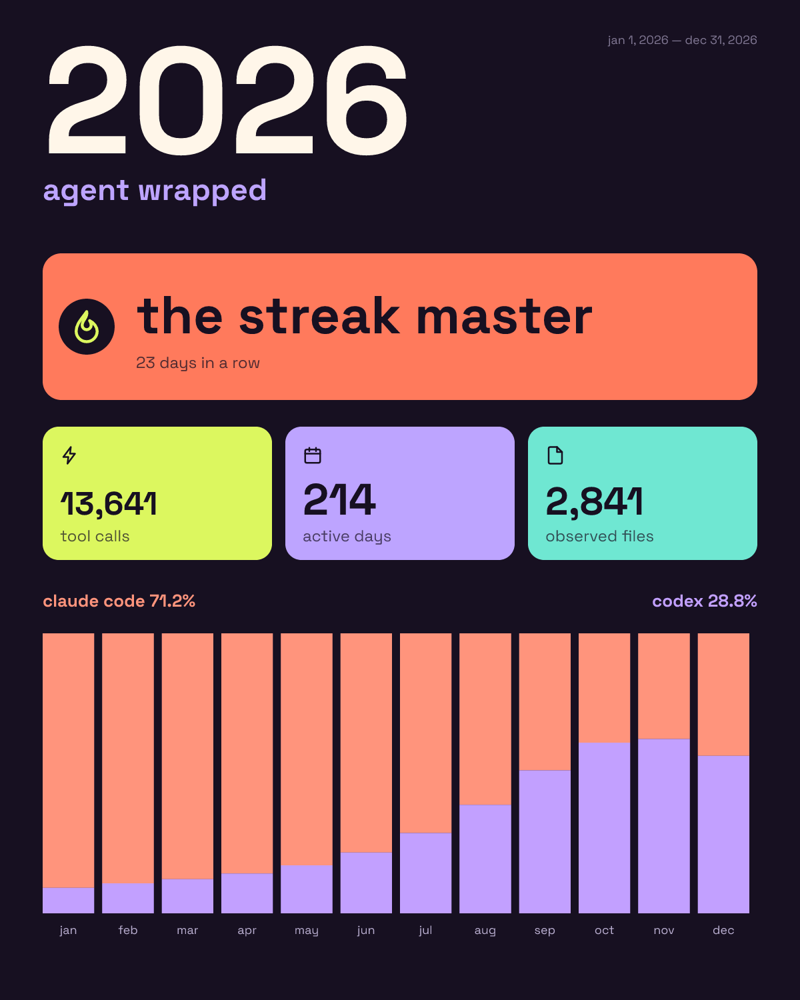

# agent-wrapped

local-only coding agent usage summaries: a personality headline, tool calls, active days, observed files, and how your agent mix changed over time. no model calls, telemetry, or uploads; summaries exclude transcript text and file paths.



the sample above uses synthetic data.

## supported sessions

- claude code: jsonl logs in `~/.claude/projects` (`assistant` tool-use blocks).
- codex: jsonl logs in `~/.codex/sessions` (`response_item` function, custom, and native tool calls).

## recognized tool calls

| source | tools |
| --- | --- |
| claude code | `Read`, `Write`, `Edit`, `MultiEdit`, `NotebookEdit`, `Bash`, `Glob`, `Grep`, `WebFetch`, `WebSearch`, `Task`, `Agent` |
| codex | `exec_command`, `shell`, `shell_command`, `write_stdin`, `apply_patch`, `view_image`, `spawn_agent`, `send_input`; native web search, local shell, tool search, and image generation |

unknown tools and native image generation count as `other`. file counts cover explicit file references and patch headers, including attempted operations. shell commands are never executed or inspected for file effects; nested calls inside code wrappers are not inferred.

## install

from source (npm publishing is a separate step):

```sh
npm install git+https://github.com/mlekhi/agent-wrapped.git
agent-wrapped --source claude --save my-poster.png
```

local development requires node 22+:

```sh
npm ci
npm test
npm run build
node dist/src/cli.js --help
```

## usage

```sh
agent-wrapped                         # both agents, current year → wrapped.png
agent-wrapped 2025
agent-wrapped --source claude
agent-wrapped --save my-poster.png
```

`--source` accepts `all` (default), `claude`, or `codex`. `--from` and `--to` take inclusive `YYYY-MM-DD` dates instead of a year. `--claude-dir` and `--codex-dir` override the default log roots. `--save` defaults to `wrapped.png`; existing files are never overwritten. errors use fixed messages and a nonzero exit, and `--help` lists every option.

outputs a 1200 × 1500 png with bundled space grotesk fonts ([license](assets/fonts/license.txt)). no browser, system fonts, runtime downloads, telemetry, or uploads; logs are read locally and never modified, and the image contains only counts and fixed labels. large counts use compact notation. agent shares reflect tool calls, not elapsed time or productivity. rendering uses the native `@resvg/resvg-js` package.
